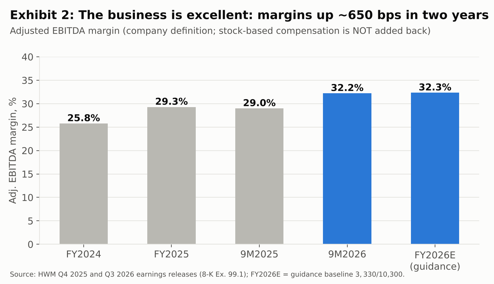
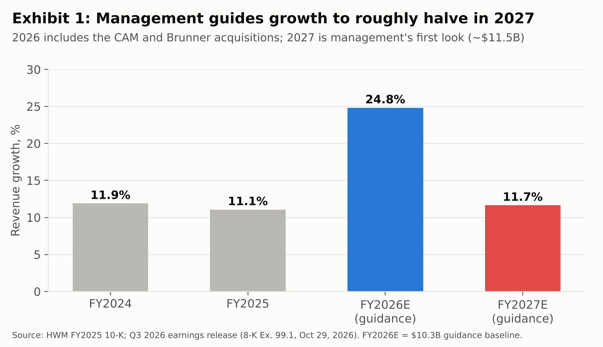
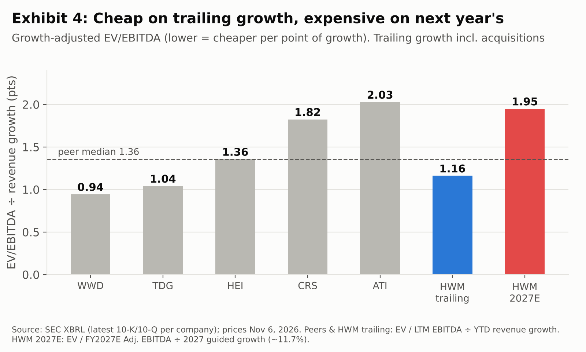
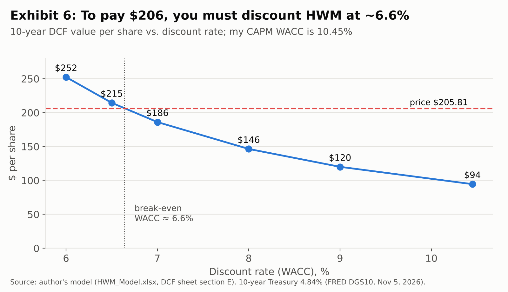
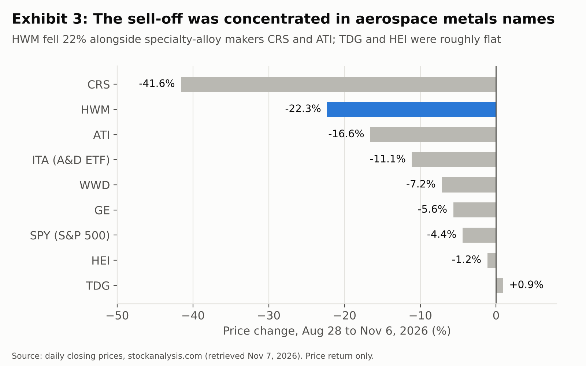
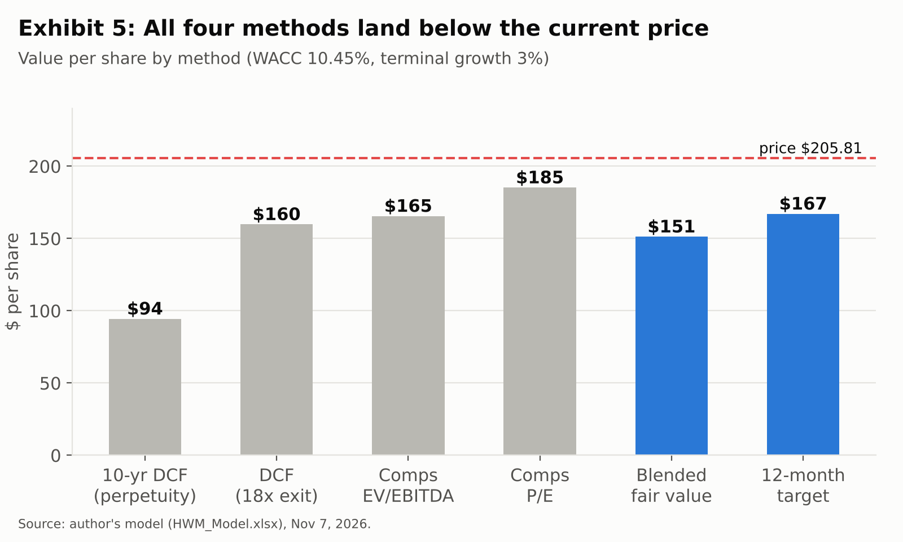

# Howmet Aerospace (HWM): Pricing a Peak Year as Permanent

### A great business at the wrong price. Short, 12-month target $167.

| | |
|---|---|
| **Recommendation** | SHORT (valuation-driven, moderate conviction) |
| **Price at publication** | $205.81 (Nov 6, 2026 close) |
| **12-month price target** | $167 (by Nov 6, 2027) |
| **Expected total return** | about –19% |
| **Stop-loss** | Close above $245 |
| **What would change my mind** | 2027 EBITDA guidance implying ≥20% growth, or evidence that gas turbines can sustain 30%+ growth |

*Published November 7, 2026. All company financials come from Howmet's SEC filings. Model, exhibits, and sources are linked at the end. I'm a student building a public track record; this is not investment advice.*

---

## TL;DR

- **The business is excellent.** In two years Adj. EBITDA margin rose from 25.8% to 32.5%, free cash flow is 95% of net income, and Fitch now rates the debt A-.
- **The stock prices 2026 as if it were the new normal.** Revenue growth is about 25% this year, mainly from new acquisitions, while management's own 2027 outlook implies about 12%. Measured against trailing growth, HWM looks cheap; measured against next year's growth, it is the second-most expensive name in its peer group.
- **The math only works at a 6.6% discount rate.** My 10-year DCF needs a cost of capital about 4 points below CAPM to justify $206. All four of my valuation methods land below today's price.

## Where I differ from the market

**What the market seems to believe:** Howmet is a scarce, high-quality aerospace compounder that deserves 26x EBITDA on 2026 numbers, and the current growth rate will last long enough to grow into that multiple.

**What I believe:** The quality is real, but 2026 is an unusually strong year. That's my view, not something management has said. Growth is being helped by acquisitions, a surge in gas turbines, and a spare-parts cycle all at once. Management's first look at 2027 already implies growth will roughly halve. When the growth rate normalizes, the multiple usually comes down too.

## The business in 60 seconds

Howmet makes engineered metal parts that are hard to make and harder to replace: turbine airfoils, rings, fasteners, titanium structures, and forged truck wheels. Engine Products is 54% of sales and 61% of segment EBITDA. By end market, commercial aerospace is 53% of 9M2026 revenue, defense 15%, commercial transportation 15%, and gas turbines 13%. RTX and GE Aerospace were each about 11% of 2025 sales.

There are three reasons the margins are durable:

1. **Qualification barriers.** Engine parts must be certified program by program, so switching suppliers is slow and risky. The 10-K names few real rivals in castings and forgings; the main one is Precision Castparts, which Berkshire Hathaway owns.
2. **Pricing power, stated in a legal filing.** The Q3 10-Q says price increases are "in excess of material and inflationary cost pass through."
3. **Aftermarket pull.** Management repeatedly credits "engine spares" growth. Spares aren't broken out in the filings, so I can't size this.

I'm not arguing against any of that. My argument is about what you pay for it.

## Thesis 1: The market is paying for a growth rate that management says is temporary

Howmet started 2026 guiding to $9.1B of revenue and $4.45 of Adj. EPS. Today the guidance is $10.3B and $5.50. Some of that raise is real outperformance: organic growth was 25% in Q3. Some of it is bought. CAM (about $1.8B from Stanley Black & Decker, closed April 6) and Brunner (about $120M) are now in the numbers.

Management's 2027 revenue outlook of about $11.5B means growth falls from 24.8% to 11.7%. That's still a good business. But look at what happens to the valuation when you divide the multiple by the growth rate.

On trailing growth, HWM trades at 1.16 points of EV/EBITDA per point of growth. That's **cheaper** than the peer median of 1.36. A bull would show you that number. On 2027 guided growth, the figure jumps to 1.95, among the most expensive in the group. The stock price is betting on the first view. I'm betting on the second, and management's own outlook supports the second.

## Thesis 2: The price needs an unrealistically low discount rate

I built a 10-year DCF: five explicit years (FY2027–31) anchored to guidance, followed by a five-year fade from 6% growth to a 3% terminal rate. My FY2026E EPS of $5.43 is within $0.08 of management's $5.50, so the model isn't stacked against the company. Margins expand to 34%, and the model assumes management hits its targets.

At a 10.45% WACC (beta 1.20, in line with published estimates of 1.14–1.21), the DCF says **$94 per share**. The more useful question is what discount rate makes the DCF equal today's price.

**The break-even rate is about 6.6%.** That's less than 2 points above the 10-year Treasury (4.84%) for an equity whose beta is about 1.2. A reverse DCF on the 5-year model makes the same point another way: the price requires Howmet to still trade at about 24x EBITDA in 2031, after five more years of growth.

## Thesis 3: Cash yield is below Treasuries and the capital cycle is turning

At $205.81 the FCF yield on 2026 guidance is **2.4%**, about half the 10-year Treasury yield. Management also says its capital plans "envisage elevated spend beyond 2027" for aerospace and gas-turbine capacity. Capex rose from 3.3% of sales in 2023 to 5.5% in 2025. Trade working capital grew from $1,783M to $2,260M in nine months.

Howmet can easily afford this. But the investment itself is the industry's response to tight supply, and tight supply is the reason pricing power exists. As new capacity arrives, pricing power tends to erode.

## What the 22% drop does and doesn't tell us

A fair objection: hasn't the stock already corrected? HWM fell 22% from $264.85 on Aug 28 to $205.81 on Nov 6.

The selloff was concentrated among aerospace metals names. Carpenter fell 42% and ATI 17%, while TransDigm and HEICO were roughly flat and the S&P 500 fell 4%. I couldn't find a sourced reason in the filings, so I'm not assuming one. Two observations, though:

1. Howmet *rose* 5.5% on its Q3 earnings day (Oct 29). The drop doesn't look like a reaction to Howmet's own results.
2. Even after the drop, HWM trades at 25.9x 2026 EBITDA guidance, a 23% premium to the peer median on LTM EBITDA. The de-rating has started, but it hasn't finished.

## Valuation

| Method | Value / share | Key assumption |
|---|---|---|
| 10-year DCF (perpetuity) | $94 | WACC 10.45%, terminal growth 3% |
| 5-year DCF (exit multiple) | $160 | 18x FY2031E EBITDA |
| Comps: EV/EBITDA | $165 | Peer median 22.9x LTM |
| Comps: P/E | $185 | Peer median 36.3x LTM |
| **Equal-weight blend** | **$151** | |

I roll the $151 blend forward one year at my 10.8% cost of equity and subtract $0.56 of dividends. That gives a **$167 target**.

The honest caveat: the DCF does a lot of the work. Without it, the blend gives about $188, roughly –8%, which by my pre-set ±15% rule is a NEUTRAL call, not a short. I've kept it because it's the only method that doesn't depend on what other aerospace stocks happen to be trading at. Readers who don't trust DCFs should read this as "avoid," not "short."

## Catalysts and signposts

| When | Event | Bearish if… | Bullish if… |
|---|---|---|---|
| ~Feb 2027 | Q4 2026 results and full 2027 guidance (last year's came Feb 12) | 2027 EBITDA growth ≤ revenue growth (~12%) | EBITDA growth ≥ 20% or 2027 revenue raised above $11.5B |
| By end-2026 | Final CAM purchase-price allocation | Higher amortization, continued Fastening margin dilution (–140 bps in Q3) | Clean integration, margins recover |
| 2027 | Capex plans | Capex step-up above 5.5% of sales | Capex flat and FCF conversion ≥ 95% |
| Ongoing | Aircraft build rates and engine shop visits | Any delivery or shop-visit slowdown | Faster narrowbody ramp |

## The bull case (steelmanned)

- **Beat-and-raise momentum.** Guidance has risen through the year, and shorting into upgrades is how valuation shorts lose money.
- **Buybacks.** The new $5B authorization brings the total to $5.4B, about 6.6% of market cap.
- **Gas turbines.** Revenue grew 45% in Q3, and customers want volumes "beyond previous expectations." If this becomes a second aerospace-sized business, my 6–9% outer-year growth assumption is too low.
- **Scarcity.** There are very few listed pure-play aerospace compounders, and the market may keep paying up for one.

If the bull case is right, my bull scenario (26x exit multiple, 8.5% WACC) is worth about $243, roughly +18%. That's why I'd size this small.

## Risk management

- **Position size:** small, because the call is valuation-driven.
- **Stop-loss:** a close above $245, about +19%, symmetric to the expected downside.
- **Review dates:** Q4 results (~Feb 2027) and every quarterly report after that.
- **Exit early** if the bullish column in the catalyst table starts filling in.

## Bottom line

I'd be glad to own Howmet's business; I'm not willing to pay a 2.4% FCF yield and a 6.6% implied discount rate for it. **Short HWM, 12-month target $167, dated November 7, 2026.**

---

*Disclosure: I hold no position in HWM.*

*Sources:*
- *Howmet FY2025 Form 10-K and Q3 2026 Form 10-Q, plus earnings releases (8-K Ex. 99.1, Feb 12 and Oct 29, 2026), via SEC EDGAR.*
- *Peer fundamentals from each company's latest 10-K/10-Q (SEC XBRL).*
- *Prices are daily closes from stockanalysis.com.*
- *10-year Treasury yield from FRED (DGS10).*
- *Beta cross-checked against Yahoo Finance (1.19) and Dividend Vision (1.21).*
- *Full model (live formulas): HWM_Model.xlsx.*
